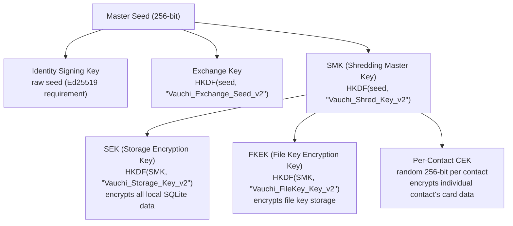
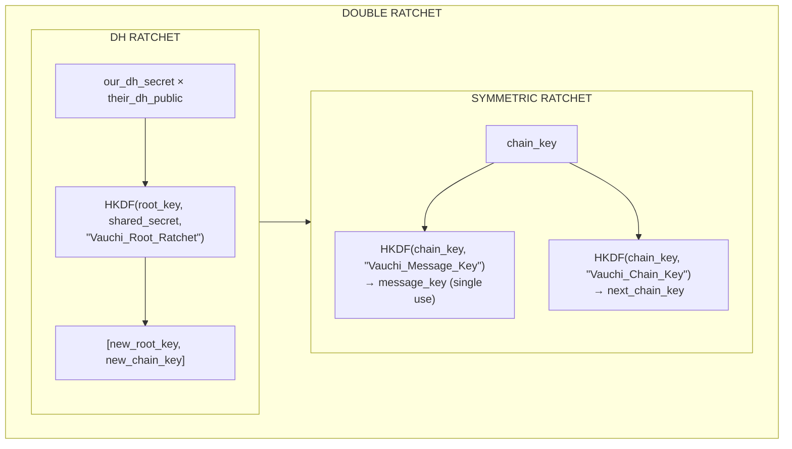

<!-- SPDX-FileCopyrightText: 2026 Mattia Egloff <mattia.egloff@pm.me> -->
<!-- SPDX-License-Identifier: GPL-3.0-or-later -->

# Cryptography Reference

Concise reference for all cryptographic operations in Vauchi.

## Algorithms

| Purpose | Algorithm | Library | Notes |
|---------|-----------|---------|-------|
| **Signing** | Ed25519 | `ed25519-dalek` | Identity, registry |
| **Key Exchange** | X25519 | `x25519-dalek` | X3DH + identity binding |
| **Sym. Encrypt** | XChaCha20-Poly1305 | `chacha20poly1305` | 192-bit nonce |
| **Forward Secrecy** | Double Ratchet | `hkdf` + `hmac` | Chain limit 2000 |
| **Key Derivation** | HKDF-SHA256 | `hkdf` | RFC 5869 |
| **Password KDF** | Argon2id | `argon2` | m=64MB, t=3, p=4 |
| **CSPRNG** | OsRng | `rand` | OS entropy |
| **TLS** | TLS 1.2/1.3 | `rustls` (`aws-lc-rs`) | Relay transport + SPKI pinning |
| **IP Privacy** | OHTTP (RFC 9458) | `ohttp` (`rust-hpke`) | Unlinks client IP from request |

**Post-quantum (planned, ADR-060 / ADR-062).** Key agreement is
classical-only today. A hybrid X25519 + ML-KEM-768 upgrade is planned to
close the
harvest-now-decrypt-later gap on relay-carried ciphertext; signatures
(Ed25519) migrate later since they are not harvest-now-forge-later.

## Key Types

### Identity Keys

| Key | Type | Size | Purpose |
|-----|------|------|---------|
| Master Seed | Symmetric | 256-bit | Root of all keys |
| Signing Key | Ed25519 | 32+64 bytes | Identity, signatures |
| Exchange Key | X25519 | 32 bytes | Key agreement |

### Storage Keys (Shredding Hierarchy)



**HKDF Convention**: Master seed as IKM, no salt,
domain string as info. All derivations use
`HKDF::derive_key(None, &seed, info)`.

**HKDF Context Strings**:

| Context | Usage |
|---------|-------|
| `Vauchi_Exchange_Seed_v2` | Exchange key derivation from master seed |
| `Vauchi_Shred_Key_v2` | SMK derivation from master seed |
| `Vauchi_Storage_Key_v2` | SEK derivation from SMK |
| `Vauchi_FileKey_Key_v2` | FKEK derivation from SMK |
| `vauchi-x3dh-symmetric-v2` | X3DH transcript binding (4-key HKDF info) |
| `vauchi-x3dh-key-v2` | X3DH key agreement derivation |
| `Vauchi_Root_Ratchet` | DH ratchet root key step |
| `Vauchi_Message_Key` | Symmetric ratchet message key |
| `Vauchi_Chain_Key` | Symmetric ratchet chain key advance |
| `Vauchi_AnonymousSender_v2` | Anonymous sender ID derivation |
| `Vauchi_Mailbox_v1` | Contact mailbox token (daily rotation) |
| `Vauchi_DeviceSync` | Device-to-device encryption key derivation |
| `Vauchi_DeviceSync_v1` | Device sync self-token (daily rotation) |

### Ratchet Keys

| Key | Type | Lifecycle |
|-----|------|-----------|
| Root Key | 32 bytes | Updated on DH ratchet |
| Chain Key | 32 bytes | Advances with each message |
| Message Key | 32 bytes | Single-use, deleted after |

**One ratchet per contact, or per device pair.** A contact's updates
run through one Double Ratchet per `(contact, device pair)` once both
sides hold each other's signed device registry and have completed
the registry activation handshake; until then, and for contacts that
never complete it, one ratchet per contact carries the updates and
every device of the contact receives the same copy. Device-to-device
sync between a person's own devices does not use a ratchet at all:
it is encrypted under a static agreement between the two devices'
exchange keys, so it has no forward secrecy. The
[Security Claims](security-claims.md) page scopes the forward-secrecy
claim accordingly.

## Ciphertext Format

```
algorithm_tag (1 byte) || nonce || ciphertext || tag
```

| Tag | Algorithm | Nonce | Notes |
|-----|-----------|-------|-------|
| `0x01` | AES-256-GCM | 12 bytes | Removed — no longer supported |
| `0x02` | XChaCha20-Poly1305 | 24 bytes | Default since v0.1.2 |
| `0x03` | XChaCha20-Poly1305 + AD | 24 bytes | Double Ratchet (header-bound) |

Tag `0x03` binds message header as AEAD associated
data to prevent relay manipulation.

## Message Padding

All messages padded to fixed buckets before encryption:

| Bucket | Size | Typical Content |
|--------|------|-----------------|
| Small | 256 B | ACK, presence, revocation |
| Medium-Small | 512 B | Short card deltas, single-field updates |
| Medium | 1 KB | Card deltas, small updates |
| Large | 4 KB | Media references, large payloads |

Messages > 4 KB: rounded to next 256-byte boundary.

Format: `[4-byte BE length prefix] [plaintext] [random padding]`

## X3DH Key Agreement

Full X3DH with identity binding (no signed pre-keys):

### QR / Mutual Exchange (Symmetric)

```
Both sides:
  ephemeral ← generate X25519 keypair
  shared_bytes ← DH(our_ephemeral_secret, their_ephemeral_public)

  // Transcript binding: all four public keys sorted lexicographically
  // and appended to info, preventing identity misbinding attacks
  info ← "vauchi-x3dh-symmetric-v2" || sort(id_lo, id_hi) || sort(eph_lo, eph_hi)
  shared ← HKDF(ikm=shared_bytes, salt=None, info=info)
```

### NFC/BLE Exchange

Same as Mutual QR — fresh ephemeral keys on both
sides, HKDF-derived shared secret.

### Link Exchange (Asynchronous, via Relay Escrow)

A link lets two people exchange cards without being in the same
place. It is weaker than an in-person exchange and the docs say so:
see claim 9 on the [Security Claims](security-claims.md) page.

**The link.** The sender's device makes a fresh X25519 key pair and a
random 32-byte nonce, and puts both in the fragment of an https URL,
so a browser never sends them to any server:

```
https://vauchi.app/x#pk=<base64url ephemeral public key>&n=<base64url nonce>&v=2[&nm=<base64url name>]
```

The optional name is at most 64 bytes and is unchecked: anyone can put
any name in a link, so the app shows it only as a claim. The landing
page hands an installed app the same values as `vauchi://exchange?`. A
link without `v=2` is refused: it has no code behind it.

**The code.** The sender's device also draws a six-digit code and shows
it next to the link. It is never in the link. The person sends it another
way, such as a call or a different app, and whoever opens the link has to
type it before anything reaches the relay.

**Rendezvous.** Both devices meet in the relay's escrow, addressed by
hashes neither the relay nor a reader of the URL can turn back into
keys:

```
handshake gate   ← SHA-256(nonce || "handshake")
sender's slot    ← SHA-256(nonce || "initiator_presence")
```

The sender deposits its ephemeral public key and a SPAKE2 message in
that slot. Whoever opens the link and types a code makes their own
ephemeral X25519 key pair, deposits it with their own SPAKE2 message as
the second slot of the same gate, and reads the sender's. Both sides
compute the Diffie–Hellman shared secret and finish symmetric SPAKE2
(`spake2` over Ed25519, with the code as the password and
`"vauchi-link-pake-v1" || nonce || pk_i` as the identity), which gives a
key only if both typed the same code. A small-order public key is
rejected on both sides (non-contributory DH), and so is a side's own
SPAKE2 message reflected back to it.

**Escrow keys.** From the shared secret and the PAKE key, each side
derives the same gate and card key, and one slot each, with
domain-separated HKDF:

```
ikm       ← shared || pake_key
gate_hash ← SHA-256(HKDF(ikm, info="vauchi-escrow-pake-gate-v1"))
slot      ← HKDF(ikm, info="vauchi-escrow-pake-slot-init-v1" | "vauchi-escrow-pake-slot-resp-v1")
card_key  ← HKDF(ikm, info="vauchi-escrow-pake-card-key-v1")
```

With a wrong code the two sides derive different values, so they sit in
different gates, no card reaches anyone, and each session ends at its
five-minute deadline. There is no separate check that could be forgotten,
and no answer that would let a guess be tested. The opener's slot in the
handshake gate is written once, so a link gets one guess.

Each side encrypts its card payload with `card_key` and deposits it in
its slot; each retrieves the other's. Deposits expire after seven
days.

**The signed bootstrap.** The card payload is version 3 only:

```
[0x03] || signature[64] || JSON { identity_pubkey, x3dh_pubkey, relay_url, card }
signature ← Ed25519(identity) over "vauchi-link-bootstrap-v3" || nonce || pk_i || pk_r || JSON
```

The signature covers the whole payload, the card included, and the
exchange it was made for: the link's nonce and both ephemeral keys.
The responder signs once its ephemeral key exists; the initiator signs
after it has read the responder's key. The parser verifies the
signature against the embedded identity key and its own side's nonce
and keys, and rejects anything else, so a relay or a link reader cannot
rewrite the card, substitute a key or a relay address, or replay a
payload into another exchange.

**Completion.** With the peer's identity and X3DH keys, both sides run
the full X3DH below (`vauchi-x3dh-key-v2`), derive the same shared
key, and start the Double Ratchet. The contact id is the hex of the
peer's identity key. Completing twice keeps the existing contact and
its ratchet; a link that leads back to our own identity is rejected;
the per-identity contact limit applies.

**What a link does not do.** The code proves someone holds it, not who
they are, and it protects nothing if it travels with the link. An attacker
with only the link gets one guess in a million and cannot test guesses
offline, but can still use the link up, so the intended person is told it
was already used and has to ask for a new one. The sender's name is not
authenticated. `spake2` has not been independently audited; if it were
broken the exchange would fall back to whoever opens the link first, with
the card still sealed from the relay. A link contact is `Remote`, below
Standard. The user can raise it to Verified by comparing key fingerprints
over a channel they already trust; that step is recorded as its own level
and never set by hand.

### Relay-Mediated Exchange (Short Code + Fingerprint)

Two people on a call can exchange through the relay with a short
numeric code and confirm it by comparing an authentication fingerprint.
The short code only finds the offer; it authenticates nothing.

1. The initiator starts the exchange and gets a short numeric code.
2. The responder enters the code and claims the exchange. The
   responder acts as the X3DH initiator and generates the ephemeral
   key; the offer's owner acts as the X3DH responder.
3. The initiator completes the exchange once the claim arrives.
4. Both sides compare the fingerprint their device shows.

The fingerprint (`derive_sas`, a name kept for its callers) binds the
shared secret to both identities and is the same on both sides whoever
started:

```
tag ← HMAC-SHA256(key=shared_x3dh_secret,
                  "vauchi-relay-exchange-sas-v1" || sort(identity_a, identity_b))
fingerprint ← all 32 tag bytes, lowercase hex, eight groups of eight
              characters separated by hyphens
```

A mismatch means a party in the relay path substituted keys, and the
exchange must be discarded. The fingerprint is not truncated because
the relay can choose both transcripts adaptively, so a short code would
fall to a collision search. The protocol does not wait for the
comparison: the contact exists whether or not anyone compares.

### Full X3DH (Asymmetric)

Used by link and relay-mediated exchanges, where one side moves first:

```
DH1 ← our_static × their_static        (identity binding)
DH2 ← ephemeral × their_static         (initiator)  |  our_static × their_ephemeral (responder)
shared ← HKDF(ikm=DH1 || DH2, salt=None, info="vauchi-x3dh-key-v2")
```

The name follows the code; the construction is two Diffie-Hellman
operations, not Signal's three or four. The responder contributes only
its long-term key: there is no signed prekey and no one-time prekey, and
the one ephemeral is the initiator's. So at this layer a responder's
long-term key, if it leaks together with the transcript, yields both
DH outputs. What keeps past messages secret is the Double Ratchet
below: both sides seed it with fresh keys (`bootstrap_exchange_ratchet`
in `exchange/ratchet_bootstrap.rs`), so every message key also depends
on key pairs that were destroyed after use. The shared secret is bound
to both long-term keys, so a stolen session key cannot be used to
impersonate either side to the other.

## Double Ratchet



Limits:

- Max chain generations: 2000
- Max skipped keys stored: 1000
- Message key deleted immediately after use

### Ratchet Message (Authenticated, Not Encrypted Header)

```rust
RatchetMessage {
    dh_public: [u8; 32],      // Current DH public key
    dh_generation: u32,       // DH ratchet step counter
    message_index: u32,       // Message index in current chain
    previous_chain_length: u32, // Messages sent in previous chain
    ciphertext: Vec<u8>,      // Encrypted payload
}
```

Header (44 bytes) bound as AEAD associated data (tag `0x03`).

## Backup Format

### v7 — Full Backup (Current)

```text
header  = [0x07] || file_id(16) || salt_0(16) || salt_1(16)
file    = header || P_0 || P_1        (P_0 and P_1 the same size)
P_i     = XChaCha20-Poly1305(K_i, frame_i; AD = header)
K_i     = HKDF-expand(HKDF-extract(none, Argon2id(password_i, salt_i)),
                      "vauchi-backup-v7-payload", 32)
frame_i = u32_be(len(z_i)) || z_i || zero bytes up to the bucket
z_i     = zlib(JSON snapshot)
```

- Two payloads, each under its own password. One holds the
  real snapshot and takes a random slot. The other is
  either a decoy snapshot under a separate decoy password,
  or a zero frame under a random key
- Both payloads are padded to the same bucket: 4 KiB,
  doubling, up to the largest size that fits twice in the
  32 MiB file. Every export draws a fresh file id, salts
  and nonces, so the file does not show which slot is
  real or whether a decoy exists
- A reader derives both keys before trying either, so a
  restore takes the same time whichever payload opens. Any
  failure, including a payload copied from another file,
  is the same decryption error
- Plaintext: the v6 snapshot with `version: 7`. Exported
  from the real profile of an install with an app password,
  it also carries the duress section: the decoy profile's
  data re-encrypted under a fresh transfer key, and the
  app password's and duress PIN's hashes, so a restored
  install locks as before
- The decoy payload holds the decoy profile under its own
  identity, locked with the duress PIN, with no duress
  section. It is offered only on the real profile when a
  duress PIN is set
- The export refuses a backup or decoy password that
  unlocks the install, or that repeats the other
- Limits and validation as for v6. Normative text:
  Keys and Cards D4 in the protocol specification

### v6 — Full Backup (still imported)

```text
header = [0x06] || salt(16)
header || ciphertext
```

- Key derivation: Argon2id (m=64MB, t=3, p=4),
  followed by HKDF-SHA256 with domain separation
  `b"vauchi-backup-v6-state"`
- Cipher: XChaCha20-Poly1305 with the 17-byte
  header as associated data (tag `0x03`), so a
  changed version byte or salt fails the tag
  instead of deriving a wrong key
- Plaintext: zlib-compressed JSON snapshot:
  `{ version: 6, created_at, identity, own_card,
  contacts, groups, overrides }` — the v3 sections
  plus each contact's hidden, blocked, favourite,
  archived and ignored state, its relationship
  state (transport, proximity, trust metrics,
  reciprocity), the groups, and per-contact field
  overrides
- Limits: 32 MiB file, 64 MiB decompressed; the
  whole snapshot is validated before any write and
  the restore is one transaction on a fresh
  installation. Source:
  `core/vauchi-core/src/backup/snapshot/`.

The exporter writes v7; the importer accepts v7, v6
and v3. A reader from before v7 rejects a v7 file.

### v3 — Full Backup (Legacy, still imported)

```
[0x03] || salt(16) || ciphertext
```

- Key derivation: Argon2id (m=64MB, t=3, p=4),
  followed by HKDF-SHA256 with domain separation
  `b"vauchi-backup-v3"`
- Cipher: XChaCha20-Poly1305
- Plaintext: JSON `FullBackupEnvelope`

```text
FullBackupEnvelope {
  version, created_at,
  sections: {
    identity:  { display_name, master_seed_b64, device_index, device_name },
    contacts:  [ ... ],
    own_card:  ContactCard?,     // optional
    labels:    [ LabelSection ]  // optional
  }
}
```

The v3 envelope carries the full account: identity
master seed, contacts, your own card, and labels.
Per-contact Double Ratchet state is **not** included
— it is ephemeral by design and re-established on
the next sync after restore. Source:
`core/vauchi-core/src/backup/full_backup.rs`.

### v2 — Identity-Only (Legacy)

```
[0x02] || salt(16) || ciphertext
```

- Key derivation: Argon2id (m=64MB, t=3, p=4)
- Cipher: XChaCha20-Poly1305
- Plaintext:
  `display_name_len(4) || display_name || master_seed(32) || device_index(4) || device_name_len(4) || device_name`
- **Status:** Superseded. Read path retained for
  migration; new backups are written as v6.

### v1 (Removed)

```
salt(16) || nonce(12) || ciphertext || tag(16)
```

- Key derivation: PBKDF2-HMAC-SHA256
- Cipher: AES-256-GCM
- **Status:** Removed from codebase. Documented for format reference only.

## Transport Encryption

The shipping client (`vauchi-core`) talks to the
relay over the **HTTP v2 protocol**: a synchronous
request/response API (suited to contact-card sync,
not real-time chat), carried over **TLS 1.3** with
SPKI certificate pinning. The WebSocket + Noise
modules were removed from the client in favour of
HTTP v2 (`core/vauchi-core/src/network/mod.rs`:
"websocket and noise modules removed — relay uses
HTTP v2 transport").

### Oblivious HTTP (OHTTP, RFC 9458)

To unlink the client's IP address from its requests,
HTTP v2 requests are encapsulated with **OHTTP** and
sent through an **OHTTP relay** to a separate **OHTTP gateway**:

- Gateway key config is fetched from
  `GET /v2/ohttp-key` (`application/ohttp-keys`).
- Each request is encapsulated single-use
  (`OhttpClient::encapsulate`), HPKE-sealed to the
  gateway.
- **ADR-037 requires the gateway operator and the
  relay operator to be distinct entities** — the
  gateway sees the client IP but not the (sealed)
  request; the relay sees the request but only the
  gateway's IP. Neither sees both.

The protocol supports this separation, but the
current Vauchi deployment operates both hops. Since
October 2026 they run on separate hosts, linked by a
private tunnel: compromising one host no longer
exposes both sides. One operator still runs both, so
this does not provide the distinct-operator guarantee.
This limitation concerns IP and timing metadata, not
the end-to-end encryption of contact-card contents.

Source: `core/vauchi-core/src/network/http_transport.rs`,
`core/vauchi-core/src/network/ohttp_client.rs`,
`relay/src/ohttp_gateway.rs`.

### Mailbox Routing (Daily-Rotating Tokens)

The relay routes messages by tokens, not identities; guardian sets, recovery proofs and purge requests use the identity key or its hash. Messages are
addressed to **daily-rotating mailbox tokens**,
`HKDF(shared_key, day_epoch, "Vauchi_Mailbox_v1")`,
which both parties derive independently for a given
UTC day (`day_epoch = unix_time / 86400`). Clients
register today's and yesterday's tokens to absorb
clock skew. Source:
`core/vauchi-core/src/network/mailbox_token.rs`.

### Noise NK (Removed — Historical)

The original relay transport was a Noise NK inner layer
(`Noise_NK_25519_ChaChaPoly_BLAKE2s`) over WebSocket, as
defense-in-depth inside TLS. It is fully retired: the
shipping client migrated to HTTP v2 + OHTTP (ADR-004,
superseded), and the relay's Noise NK implementation —
the `snow` dependency and the Noise transport — was
deleted. The relay keeps only its X25519 identity
keypair, from which its Ed25519 federation signing key
is derived; no client or relay performs a Noise
handshake. (A residual relay identity public key field
still rides in the discovery payload, unused by clients.)

## Security Properties

| Property | Mechanism |
|----------|-----------|
| **Confidentiality** | XChaCha20-Poly1305 encryption |
| **Integrity** | AEAD authentication tag |
| **Authenticity** | Ed25519 signatures |
| **Forward Secrecy** | Double Ratchet, message keys deleted |
| **Break-in Recovery** | DH ratchet with ephemeral keys |
| **No Nonce Reuse** | Random 24-byte nonces |
| **Memory Safety** | `zeroize` on drop for all keys |
| **Traffic Analysis Reduction** | Bucket-size message padding (reduces, does not remove, size and timing metadata) |
| **Replay Prevention** | Double Ratchet counters |
| **Transport Encryption** | TLS 1.3 + SPKI certificate pinning (HTTP v2) |
| **Network-Location Privacy** | Oblivious HTTP (RFC 9458); gateway on a separate host, same operator today |
| **Unlinkable Routing** | Daily-rotating mailbox tokens |

## Source Files

Paths are in the [core repository](https://gitlab.com/vauchi/core).

| Module | Path |
|--------|------|
| Key Derivation | [`vauchi-core/src/crypto/kdf.rs`](https://gitlab.com/vauchi/core/-/blob/main/vauchi-core/src/crypto/kdf.rs) |
| Signing | [`vauchi-core/src/crypto/signing.rs`](https://gitlab.com/vauchi/core/-/blob/main/vauchi-core/src/crypto/signing.rs) |
| Encryption | [`vauchi-core/src/crypto/encryption.rs`](https://gitlab.com/vauchi/core/-/blob/main/vauchi-core/src/crypto/encryption.rs) |
| Double Ratchet | [`vauchi-core/src/crypto/ratchet.rs`](https://gitlab.com/vauchi/core/-/blob/main/vauchi-core/src/crypto/ratchet.rs) |
| Chain Key | [`vauchi-core/src/crypto/chain.rs`](https://gitlab.com/vauchi/core/-/blob/main/vauchi-core/src/crypto/chain.rs) |
| CEK | [`vauchi-core/src/crypto/cek.rs`](https://gitlab.com/vauchi/core/-/blob/main/vauchi-core/src/crypto/cek.rs) |
| Shredding | [`vauchi-core/src/crypto/shredding.rs`](https://gitlab.com/vauchi/core/-/blob/main/vauchi-core/src/crypto/shredding.rs) |
| Password KDF | [`vauchi-core/src/crypto/password_kdf.rs`](https://gitlab.com/vauchi/core/-/blob/main/vauchi-core/src/crypto/password_kdf.rs) |
| X3DH | [`vauchi-core/src/exchange/x3dh.rs`](https://gitlab.com/vauchi/core/-/blob/main/vauchi-core/src/exchange/x3dh.rs) |
| X3DH Session (Symmetric) | [`vauchi-core/src/exchange/session.rs`](https://gitlab.com/vauchi/core/-/blob/main/vauchi-core/src/exchange/session.rs) |
| Link Exchange | [`vauchi-core/src/exchange/link_mode.rs`](https://gitlab.com/vauchi/core/-/blob/main/vauchi-core/src/exchange/link_mode.rs) |
| Relay Escrow Keys | [`vauchi-core/src/exchange/escrow.rs`](https://gitlab.com/vauchi/core/-/blob/main/vauchi-core/src/exchange/escrow.rs) |
| Relay exchange fingerprint | [`vauchi-core/src/exchange/relay_exchange.rs`](https://gitlab.com/vauchi/core/-/blob/main/vauchi-core/src/exchange/relay_exchange.rs) |
| Padding | [`vauchi-core/src/crypto/padding.rs`](https://gitlab.com/vauchi/core/-/blob/main/vauchi-core/src/crypto/padding.rs) |
| HKDF Test Vectors (RFC 5869) | [`vauchi-core/tests/it/crypto_kdf_tests.rs`](https://gitlab.com/vauchi/core/-/blob/main/vauchi-core/tests/it/crypto_kdf_tests.rs) |
| Vauchi Test Vectors | [`vauchi-core/tests/it/protocol_test_vectors_tests.rs`](https://gitlab.com/vauchi/core/-/blob/main/vauchi-core/tests/it/protocol_test_vectors_tests.rs) |

## Related Documentation

- [Glossary](glossary.md) — Terms and acronyms used here
- [Architecture Overview](architecture.md) — System design
- [Threat Model](threat-model.md) — STRIDE analysis and mitigations
- [Security Claims](security-claims.md) — Each claim with its proof
- [Formal Verification](formal-verification.md) — Models and lemmas
- [Test Vectors](test-vectors.md) — Known-answer values for the
  derivations on this page
- [Encryption Feature](../users/features/encryption.md)
  — User-friendly explanation
- [Security](../about/security.md) — Security model overview
