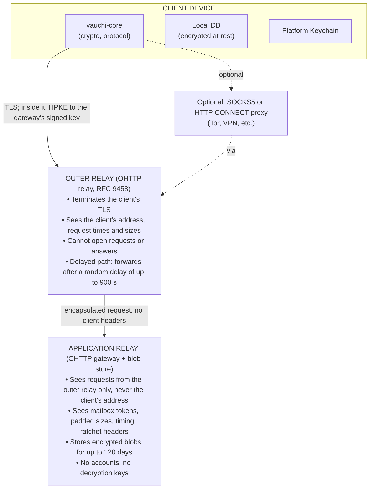

<!-- SPDX-FileCopyrightText: 2026 Mattia Egloff <mattia.egloff@pm.me> -->
<!-- SPDX-License-Identifier: GPL-3.0-or-later -->

# Threat Model

Formal threat analysis of the Vauchi system using the STRIDE framework.

---

## System Context

Vauchi is a **contact card exchange** system, not a messaging app:

- **Traffic pattern**: Generated when users
  physically meet (exchange) or update contact
  info (small delta to all contacts)
- **Data type**: Contact cards (name, phone, email, address, social handles)
- **Exchange model**: In-person only via QR code, NFC, or BLE
- **Update frequency**: Infrequent (users rarely change phone numbers or emails)
- **Update size**: Small (delta of changed fields, typically < 1 KB)

This context shapes the threat model: low traffic
volume and infrequent updates reduce the value of
traffic analysis compared to messaging apps.

## Trust Boundaries

| Boundary | Protection | What that party sees |
|----------|-----------|----------------------|
| Client ↔ Outer relay | TLS (WebPKI, optional SPKI pin) + OHTTP encapsulation | The address, not the content |
| Outer relay ↔ Application relay | TLS; the request stays encapsulated | Content-shaped bytes, not the address |
| Both relays together | Nothing cryptographic; one operator runs both hops today | Can join address and content by timing; the delayed path is the mitigation, host separation the release gate |
| Client ↔ Client | E2E (key agreement + Double Ratchet) | Verified in person |
| Device ↔ Device | Static agreement between the devices' exchange keys | Trusted (same seed); no forward secrecy |
| Contact ↔ Contact | Per-contact CEK | Verified at exchange |

A client in production refuses to talk to the application relay
directly: every data request goes through the outer hop, and the
gateway's key is accepted only under a signed chain from an anchor
compiled into the client.

## Assets

| Asset | Sensitivity | Description |
|-------|-------------|-------------|
| Contact card data | High | Personal info (phone, email, address) |
| Identity keys | Critical | Ed25519 signing + X25519 exchange keys |
| Master seed | Critical | 256-bit root secret for all key derivation |
| Social graph | High | Who knows whom (contact relationships) |
| Update metadata | Medium | When someone changed their info |

## Adversary Model

| Adversary | Capability | Motivation |
|-----------|------------|------------|
| Passive observer | Encrypted traffic only | Surveillance |
| Malicious relay | Blobs + timing, no IPs | Data harvesting |
| Harvest-now adversary | Records ciphertext now | Decrypt at Q-Day |
| OHTTP relay | Client IP, no content | Correlation |
| Compromised device | Full device access | Targeted attack |
| Physical attacker | Steals/seizes device | Law enforcement |
| Malicious contact | Legitimate contact | Stalking |

## STRIDE Analysis

### Spoofing

**Threat**: Attacker impersonates a contact or creates a fake identity.

**Mitigations**:

- Ed25519 identity keys bound to each user
- Full-trust contact exchange requires **physical
  presence** (QR, NFC, or BLE with proximity check)
- A contact made over a shared link is weaker and
  shown as such: whoever opens the link first becomes
  a contact, with no sender approval yet (see the
  link exchange entry on the Security Claims page)
- No trust-on-first-use for contact verification:
  you verify who you connect with in person
- Device registry is cryptographically signed;
  unauthorized devices cannot be added

**Residual risk**: Social engineering (convincing
someone to scan a QR code under false pretenses).

### Tampering

**Threat**: Relay or network attacker modifies messages in transit.

**Mitigations**:

- AEAD encryption (XChaCha20-Poly1305) detects any
  modification via authentication tag
- Ed25519 signatures verify sender authenticity
- Double Ratchet counters and per-message nonces detect replay and reordering
- Device registry version numbers prevent rollback

**Residual risk**: None. Tampering is cryptographically detected and rejected.

### Repudiation

**Threat**: User denies having sent an update.

**Design decision**: Repudiation is a **privacy
feature**, not a bug. Vauchi intentionally does not
provide non-repudiation for contact card updates.
Users should be able to update or remove their
information without permanent proof of past states.

### Information Disclosure

**Threat**: Unauthorized access to contact card data.

**Mitigations**:

- All data E2E encrypted with XChaCha20-Poly1305 before leaving the device
- Per-contact encryption keys (CEK) derived via X3DH + Double Ratchet
- Forward secrecy: each message uses a unique key, deleted after use
- Relay stores only encrypted blobs (oblivious privacy-preserving design)
- Local storage encrypted with device-derived keys (SEK from HKDF key hierarchy)
- Sensitive key material zeroized on drop (`zeroize` crate)
- Message padding to fixed buckets
  (256 B, 512 B, 1 KB, 4 KB) prevents
  size-based inference

**Residual risk**: Metadata (request timing, padded
sizes, mailbox tokens) visible to the application
relay. Reduced by Oblivious HTTP (two hops, one
operator today), padding of requests and replies,
random client-side delays, and an optional SOCKS5
or HTTP CONNECT proxy in front of the outer relay
support.

### Denial of Service

**Threat**: Attacker disrupts relay availability.

**Mitigations**:

- Token-bucket rate limiting (60 msgs/min per client, configurable)
- Stricter recovery rate limit (10 queries/min, anti-enumeration)
- Connection limit (max 1000 concurrent, RAII guard)
- Multi-layer timeout protection: handshake timeout, idle timeout (5 min)
- Message size limit (1 MB)
- Automatic message expiration (120-day TTL; recovery store: 9-day TTL)
- Federation support for relay redundancy

**Residual risk**: Sustained DDoS from many source
IPs can overwhelm a single relay.

### Elevation of Privilege

**Threat**: Attacker gains unauthorized capabilities.

**Mitigations**:

- No user accounts on relay: no admin interface, no privilege levels
- Client capabilities limited to own identity (can only decrypt own messages)
- Master seed required for all identity operations
- Device linking requires physical QR scan + identity key signature verification

**Residual risk**: Compromised device with master
seed has full identity control. Mitigated by device
revocation broadcast.

## Key Security Properties

| Property | Mechanism |
|----------|-----------|
| **Confidentiality** | XChaCha20-Poly1305 E2E encryption |
| **Integrity** | AEAD authentication tag + Ed25519 signatures |
| **Forward secrecy** | Double Ratchet with ephemeral DH keys |
| **Break-in recovery** | DH ratchet step generates new key material |
| **Oblivious relay** | Encrypted blobs only, no keys |
| **Physical verification** | QR + audio / NFC / BLE (full); SAS (video) |
| **Traffic analysis resist.** | Bucket padding + daily tokens + client-side delays; not measured against a traffic analyst |
| **IP privacy** | OHTTP (RFC 9458): the application relay sees the outer relay's address only |
| **Memory safety** | Rust (no unsafe in crypto paths) + `zeroize` on drop |
| **Replay prevention** | Double Ratchet counters + version numbers |

## Attack Scenarios

### Relay Compromise

If an attacker gains full control of a relay:

- **Cannot** read contact card data (E2E encrypted)
- **Cannot** forge messages (AEAD + signatures)
- **Can** see mailbox tokens, padded sizes, arrival
  and acknowledgement times, and the ratchet header
  of every blob
- **Can** drop or delay messages: the sender sees
  the relay's acknowledgement of storage, and a blob
  dropped afterwards is noticed only at the contact's
  next update or a resync request
- **Cannot** see client IP addresses (it is reached
  through the OHTTP outer relay only; a single
  operator of both hops is the alpha's stated limit)
- **Can** observe request timing patterns (reduced by
  client-side delays: 30 s to 5 min after an
  exchange, and a randomised sync interval of 10 s
  to 5 min in the foreground and 1 to 60 min in the
  background; the relay's own delivery jitter is
  configured but not applied)
- **Can** chain one fetcher's token sets across days
  on the code as released, since consecutive days'
  fetch requests overlapped in yesterday's tokens; a
  fix in review groups requests per day, after which
  only the timing of a day's requests remains

### Device Theft

If an attacker steals a device:

- Master seed encrypted with user password via Argon2id (m=64 MB, t=3, p=4)
- Platform-native key storage (macOS Keychain, iOS Keychain, Android KeyStore)
- All key material zeroized on drop
- Weak passwords can be brute-forced (Argon2id raises cost significantly)
- **Recommendation**: Use a strong backup password,
  enable OS-level device encryption

### Recovery Impersonation

If an attacker tries to abuse social recovery:

- Must meet K contacts in person (default threshold: 3)
- Each voucher signs with their identity key
- Vouchers validated against victim's known contact list
- Conflicting recovery claims are not detected yet: the relay keeps
  one proof per old key, so contacts see only the first one uploaded
- Each helper signs its voucher's timestamp: helpers refuse claims
  older than 192 hours, and a proof whose vouchers span more than 96
  hours is refused

### In-Person Exchange

Meeting in person is Vauchi's trust anchor, so the
exchange itself deserves its own threat model. The
attacker is after three things, in ascending order of
value:

1. **The shared fields.** Whatever the card or group the
   person selected exposes. They already chose to share
   these with someone at that moment.
2. **A durable update channel.** The attacker keeps
   receiving updates until revoked. This is more than a
   paper card gives away.
3. **Recovery eligibility.** High trust is defined as
   proximity plus a close-range transport, and only
   High or Verified contacts can be chosen as recovery
   vouchers. Proximity makes a contact *eligible*; the
   person still has to pick them explicitly.

Four candidate attacks, ranked by cost, cheapest first:

| # | Attack | What it needs | Defence |
|---|--------|---------------|---------|
| 1 | **Honest-but-malicious proximity.** Mallory performs a legitimate exchange with Alice at a conference and gets all three assets. | Being in the same room | None cryptographic. Alice chose what to share, and High trust is shown as "met in person", never as "trusted"; vouching for recovery is a separate explicit choice |
| 2 | **Opportunistic capture of a displayed code.** Alice shows a code to Bob; Mallory, behind Bob, scans it too. A displayed code is a broadcast | A phone, no timing, no accomplice | A displayed code answers only the first handshake; a second scanner gets nothing. The success screen names the peer, by the peer's self-asserted name |
| 3 | **Wrong-peer pairing in a crowd.** Two pairs exchange at the same moment and Alice pairs with Carol instead of Bob | A busy venue, no malice | Both sides see the peer's name before the contact is kept |
| 4 | **Relay or man-in-the-middle.** Mallory relays between a device near Alice and an accomplice near Bob | Two devices, an accomplice, live relaying | Audio proximity raises the cost of relaying; a substituted identity shows up as the wrong name on the success screen |

Attack 4 is the one the microphone defends, and it is
the least realistic of the four when both people are
genuinely face to face: they can see each other. It
becomes meaningful only when one of them is not facing
the person they believe they are. Attack 1 is the
cheapest and is not a protocol problem; it is why the
trust level records a fact about the encounter, not a
judgement about the person.

Audio proximity is **not** distance bounding. Research
classes short-range audio as a location-limited
out-of-band channel: its security comes from short range
and attenuation through walls, not from a cryptographic
distance proof, and acoustic schemes are documented as
vulnerable to relay. The microphone therefore buys
defence in depth against attack 4, not proof of
presence, which is why no screen in Vauchi claims
"verified in person". How hard relaying this codec over
a real network actually is remains an open experiment.

## Federation Security

When relays federate (forward blobs to peer relays
for redundancy), additional trust boundaries apply.

**What a federated relay CAN see**:

- Recipient routing IDs (pseudonymous public key hashes)
- Blob sizes (padded to fixed buckets: 256, 512, 1024, 4096 bytes)
- Message creation timestamps and hop count
- Network topology via gossip protocol

**What a federated relay CANNOT see**:

- Message content (E2E encrypted)
- Sender identity (not included in federation protocol)
- Real identity behind routing IDs
- Client IP addresses (federation is relay-to-relay;
  clients reach a relay only through the OHTTP outer
  hop)

**Guarantees**:

- mTLS authentication prevents unauthorized peers
- Hop count limit prevents amplification attacks
- SHA-256 integrity verification on all federated blobs
- DNS rebinding protection: explicit resolution +
  SSRF validation before connecting to peer relays

## Device Linking (STRIDE)

| Category | Threat | Mitigation |
|----------|--------|------------|
| **Spoofing** | Scan link QR | 5-min expiry, proximity |
| **Tampering** | Modified QR | Signed by identity key |
| **Info Disclosure** | Seed intercepted | Ephemeral key encryption |
| **DoS** | Excess linking | Max 10 devices |
| **Elev. of Privilege** | Unauth device | Signed registry + version |

**Known limitation**: Currently, the full master
seed is shared during device linking (not per-device
subkeys). A compromised linked device gains full
identity control. Per-device subkey isolation is
planned for 1.0 release.

## Remote Contact Paths

There is no remote discovery: nothing lets a stranger
find or request a contact without the person's
cooperation, and none is planned, because a
mechanism that reaches people one has not met weakens
the privacy the in-person anchor protects. The two
remote paths that exist both start with something
the sender hands over: a link, or a six-digit code
spoken aloud. The link path is the weaker one, since
whoever opens the link first becomes a contact; the
code path shows both people a short authentication
string to compare. Both are described, with their
limits, on the [Security Claims](security-claims.md)
page and in the [Cryptography Reference](crypto.md).

## Known Limitations

| Limitation | Impact | Mitigation |
|-----------|--------|------------|
| Relay sees metadata | Graph inference; timing and volume per mailbox | Padding, daily tokens, OHTTP, per-day fetch requests (fix in review) |
| Device compromise | Full seed exposed | Subkeys (planned), passwords |
| Linked device = full seed | Full identity | Subkeys (planned) |
| Single relay SPOF | No sync if down | Federation (planned) |
| Blocked contacts keep data | Can't unsend | By design |
| Recovery leaks voucher PKs | Partial graph | Accepted tradeoff |
| No guardian diversity | Same circle | UX warnings (planned) |
| No key transparency | Not auditable | Signed key log (future) |
| Meeting someone is cheap | A legitimate in-person exchange grants High trust | Shown as "met in person", never "trusted"; recovery vouching is a separate explicit choice |
| Link exchange weaker | Whoever opens the link first becomes a contact | Sender approval and an out-of-band code (planned) |
| Push leaks metadata | Delivery timing | Empty push + fetch |
| Quantum HNDL | Ciphertext readable at Q-Day | Hybrid ML-KEM (ADR-060) |

## Core-UI Trust Boundary

The `vauchi-core` library is consumed by multiple
UI layers (macOS/SwiftUI, Linux-GTK, Linux-Qt, CLI,
TUI, mobile Swift/Kotlin via UniFFI). The trust
relationship between core and its callers:

**What core trusts from UI**:

- UI provides correct file paths for storage
- UI invokes lifecycle methods in the correct order (init before use)
- UI does not hold references to sensitive data after core has zeroized them

**What core does NOT trust from UI**:

- **Input lengths**: Core enforces maximum lengths
  at its API boundary (display name: 100 chars,
  field value: 1000 chars, field label: 64 chars,
  card size: 64 KB, avatar: 256 KB)
- **Field values**: Core validates phone/email
  format, URL safety, and rejects malformed data
- **Contact IDs**: Core verifies contact existence before processing updates
- **Ratchet messages**: Core validates signatures,
  AEAD tags, and replay nonces before accepting
  peer data
- **File content**: Core verifies checksums on all
  content fetched from remote servers

A compromised or buggy UI layer cannot cause `vauchi-core` to:

- Decrypt data for an unauthorized recipient
- Produce unsigned or weakly signed messages
- Skip replay detection or signature verification
- Bypass visibility label enforcement

**UniFFI surface note**: The UniFFI binding layer
does not add rate limiting at the API boundary.
Rate limiting for relay operations is enforced
server-side. UI layers should implement their own
rate limiting for user-facing operations to prevent
accidental rapid-fire calls.

## Relay Metadata Exposure Analysis

The application relay sees only encrypted blobs,
but it observes metadata that can reveal the social
graph. This section follows the Relay chapter of
the [protocol specification](https://gitlab.com/vauchi/spec),
which names the source for each row.

**What the application relay sees**:

| Datum | Visibility | Notes |
|-------|-----------|-------|
| Sender | None on a send | A send carries a mailbox token and ciphertext; the optional origin hint is an opaque AEAD blob only the recipient can open |
| Recipient (mailbox) | Daily-rotating token | HKDF of the channel's shared key, the recipient's key and the day; opaque to the relay |
| Fetch set | Up to 100 tokens per request | Groups one user's contacts for the day. On the code as released today's and yesterday's tokens travelled together, so consecutive days' sets overlapped and one fetcher was linkable across days; a fix in review sends each day's tokens in requests of their own |
| Message size | Padding bucket | 256 B, 512 B, 1 KB, 4 KB, then 256-byte steps; replies are padded to a size ladder on the way out |
| Message timing | Arrival and acknowledgement times | The relay's delivery jitter is configured but not applied; the delayed path (below) moves a fetch away from the client's connection |
| Ratchet header | In the clear inside the blob | DH public key, generation and message index |
| Identity key | On a purge, by design | And a hash of it on guardian sets and recovery proofs, so that contacts can find a recovery |

**What the outer relay sees**: the client's address,
the times and sizes of its encapsulated requests,
and which delayed tickets it collects. It cannot
open a request or an answer, and it cannot
substitute the gateway's key.

**What neither sees**:

- Message content (E2E encrypted, AEAD)
- Contact card fields (encrypted under per-contact CEK)
- Which specific contact fields changed
- The sender's identity on an update
- The client's address together with the content,
  while the two hops are separate parties

**Risk assessment for Vauchi**:

The social graph inference risk is, *by design*, **lower than for
messaging apps** because of the factors below. This is a design
expectation, not yet an empirically measured guarantee; a network
observer correlating timing across hops can still infer relationship
structure, and today one operator runs both hops.

1. Updates are infrequent (users rarely change contact info)
2. Updates are small and padded to fixed buckets
3. Mailbox tokens are pseudonymous and rotate daily
4. The application relay never sees the client's address
5. Client-side delays spread requests: 30 s to 5 min
   after an exchange, and a randomised sync interval
   of 10 s to 5 min in the foreground and 1 to 60 min
   in the background

**Current mitigations**:

1. **Oblivious HTTP** (RFC 9458) — the outer relay
   sees the client's address but cannot open the
   request; the application relay opens the request
   but sees only the outer relay's address. Vauchi
   operates both hops today, so it could correlate
   across them; separate operation is the gate for
   the first release.
2. **Delayed path** — a client may post a request
   under a ticket; the outer relay forwards it after
   a random delay of up to 900 s and holds the answer
   until the client collects it later, so the
   application relay sees the request long after the
   client's connection.
3. **Padding** — requests to the client's buckets,
   replies to the relay's size ladder, and the token
   registration list padded to a multiple of 256 and
   shuffled.
4. **Client-side timing** — the post-exchange delay
   and the randomised sync interval above. The
   relay's own delivery jitter is configured and
   tested but no request path calls it.
5. **Optional proxy** — a user-configured SOCKS5 or
   HTTP CONNECT proxy (Tor, a VPN) in front of the
   outer relay, for whoever does not want even the
   outer relay to see their address.

**Why OHTTP over Tor**: Tor's 90-120s mobile
bootstrap latency is fatal for adoption. Tor
traffic is banned or flagged in countries that
need privacy most (China, Iran, Russia). OHTTP
traffic is indistinguishable from normal HTTPS;
no special protocol signatures. Two hops give
Vauchi's low-frequency traffic the metadata
protection its threat model asks for without the
usability and censorship-resistance penalties, and
Tor remains available as the optional proxy.

**Future considerations**: Private Information
Retrieval (PIR) could eliminate recipient pseudonym
visibility entirely. Cover traffic patterns could
further reduce timing correlation. These are not
currently prioritized given Vauchi's low-frequency
traffic pattern, but remain on the architectural
roadmap for high-threat deployments.

## Key Transparency

### Current Model

Vauchi uses a **trust-on-exchange** model: during
the initial in-person exchange (QR/NFC/BLE), both
parties verify each other's Ed25519 identity keys
directly. This provides strong initial
authentication.

After the exchange, contacts receive updates via the Double Ratchet:

- If a user adds a new device, it derives keys
  from the same master seed
- Contacts receive a `DeviceRegistry` update signed
  by the existing identity key
- The ratchet provides forward secrecy and break-in recovery

### Gap

There is no append-only, auditable log of a user's
key history. A sophisticated attacker who compromises
both a relay and a user's device could theoretically:

1. Generate a new identity key for the victim
2. Distribute it to the victim's contacts via the
   compromised relay
3. Contacts would have no way to verify this is
   consistent with the victim's key history

### Accepted Tradeoff

This attack requires simultaneous compromise of both
the relay and the target device, which is beyond
Vauchi's primary threat model (relay-only
compromise). The in-person exchange provides a
strong root of trust that subsequent key changes
cannot easily override without raising suspicion
(contacts would see unexpected re-exchange
requests).

### Future Direction

A lightweight key transparency mechanism could
provide additional assurance:

- **Signed key history**: Each user maintains a
  signed append-only log of their key changes.
  Contacts can audit this log to detect
  unauthorized key modifications.
- **Cross-contact verification**: Contacts can
  compare their view of a user's key history with
  other contacts to detect divergence (split-world
  attack detection).

This is not currently implemented but is documented
as a future enhancement for high-assurance
deployments. A full CONIKS-style transparency log
is not necessary given Vauchi's decentralized
architecture and low update frequency.

## Push Notification Constraints

Push notifications (APNs for iOS, FCM for Android)
are **not currently implemented**. If they are added
in the future, the following constraint is
mandatory:

**Threat**: Naive push notifications would expose
message receipt timing to Apple/Google. Even though
the relay sees only encrypted blobs, a push
notification would link a specific device token
(tied to a real Apple/Google account) to the exact
moment a Vauchi message arrives. This undermines
the oblivious privacy-preserving relay design.

**Required pattern**: **Empty push + app-side fetch**.

1. The relay sends a push notification with
   **no payload** and **no sender information** —
   only a "wake up" signal
2. The app receives the push, connects to the
   relay independently over TLS
3. The app fetches pending messages using its
   normal encrypted channel
4. Apple/Google learn only that the app was woken
   up, not who sent a message or what it contains

This pattern is used by Signal and other
privacy-focused applications. Any implementation
of push notifications in Vauchi **must** follow
this pattern. Direct payload delivery via push is
explicitly prohibited.

## Cryptographic Primitives

| Purpose | Algorithm | Library |
|---------|-----------|---------|
| Signing | Ed25519 | `ed25519-dalek` |
| Key exchange | X25519 | `x25519-dalek` |
| Symmetric encryption | XChaCha20-Poly1305 | `chacha20poly1305` |
| Password KDF | Argon2id | `argon2` |
| Key derivation | HKDF-SHA256 | `hkdf` |
| CSPRNG | OsRng | `rand` |
| TLS | TLS 1.2/1.3 | `rustls` (`aws-lc-rs` backend) |

**Post-quantum:** key agreement is classical-only today. A hybrid
X25519 + ML-KEM-768 upgrade is planned (ADR-060) to close the
harvest-now-decrypt-later gap on relay-carried ciphertext. Ed25519
signatures are not subject to harvest-now-forge-later, so they migrate
later, not now.

For the full cryptographic specification, see the
[Cryptography Reference](crypto.md).

## Comparison with Messaging Apps

| Aspect | Vauchi | Messaging Apps |
|--------|--------|----------------|
| Traffic volume | Very low | High (continuous) |
| Timing analysis | Medium (client-side delays; no relay-side jitter) | High |
| Social graph | Low (no IPs at the application relay; fetch sets linkable across days) | High |
| Metadata | Mailbox tokens, padded sizes, timing | Sender + recip + IPs |
| IP privacy | OHTTP + optional proxy | Often server sees IPs |
| Forward secrecy | Yes (DR) | Varies |
| Relay knowledge | Encrypted blobs | Often plaintext |
| Recovery | Social vouching | Phone/cloud backup |

Vauchi's infrequent, small updates significantly
reduce the value of traffic analysis compared to
messaging apps.

## Security Reporting

Found a vulnerability? Please report it responsibly:

**Email**: security@vauchi.app

We acknowledge reports within 48 hours and do not
pursue legal action against good-faith researchers.

## Related Documentation

- [Security Overview](../about/security.md) — User-friendly security explanation
- [Cryptography Reference](crypto.md) — Full cryptographic specification
- [Architecture Overview](architecture.md) — System design
