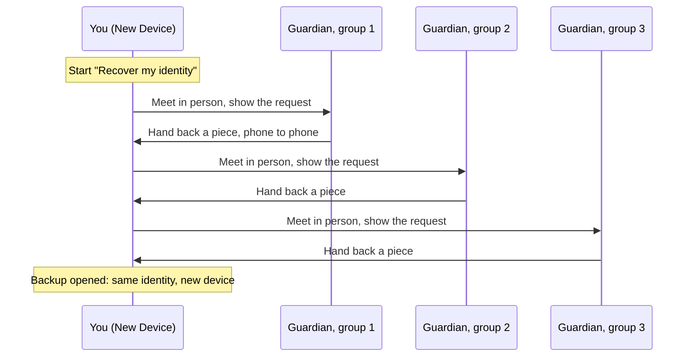

<!-- SPDX-FileCopyrightText: 2026 Mattia Egloff <mattia.egloff@pm.me> -->
<!-- SPDX-License-Identifier: GPL-3.0-or-later -->

# Backup & Recovery

Because your device is your account, losing it would matter — so Vauchi
gives you three ways back, and they're at their best when you set them
up *before* you need them. Use the first one that works; each brings you
back as **the same identity**. A second device is the quickest. A backup
is the five-minute insurance policy you'll be grateful for on a bad day.
Social recovery, the last resort, is the trick humans have always used
when documents fail: people who know you, recognizing you.

| Method | When it's for | What it needs |
|--------|---------------|---------------|
| **[Linked device](multi-device.md)** | Another device still works | That device |
| **Encrypted backup** | A planned safety net | Your backup file + password |
| **Social recovery** | Every device lost, no backup | Your guardians, in person |

A phone **stolen while unlocked** is a separate problem: getting back in
doesn't take your keys away from the thief. See
[If a device was stolen unlocked](../guides/recovery.md#if-a-device-was-stolen-unlocked).

---

## Encrypted backup

### Make one

1. Go to **Settings > Backup**
2. Tap **Export Backup**
3. Choose a strong password (it must pass the strength check)
4. Confirm it
5. Save the backup file somewhere safe

```admonish important
- Keep the backup file somewhere you'll find it (a password manager, a
  printed copy in a drawer).
- Memorise the password — it genuinely cannot be recovered.
- Backup file **plus** password equals your whole account. Guard them
  the way you'd guard the two halves of a safe combination.
```

### What's inside

A full backup is exactly that — a complete copy of your account:

| Data | Included? |
|------|-----------|
| Your identity (the master seed your keys grow from) | Yes |
| Your contacts | Yes |
| Your own card | Yes |
| Your labels and groups | Yes |
| Per-conversation forward-secrecy keys | No* |

\*Those short-lived keys are *meant* to be disposable — that's what
gives you forward secrecy. After you restore, each secure channel simply
re-establishes itself the next time you and a contact sync. You get your
people back without dragging yesterday's throwaway keys along.

### Restore from it

1. Install Vauchi on the new device
2. Choose **Restore from Backup**
3. Provide your backup file
4. Enter your password
5. You're back

Your identity, contacts, card, and labels return intact, and secure
channels re-form on the next sync.

### How the backup is protected

- **Encryption:** XChaCha20-Poly1305
- **Key stretch:** Argon2id — deliberately slow and memory-hungry, so
  guessing the password is expensive even with serious hardware
- **Without the password:** the file is meaningless noise

Reach for a passphrase, not a password: a handful of ordinary words
strung together is both easier to remember and harder to crack than the
clever tangle of symbols you'll have forgotten by Tuesday.

## Social recovery

Lost every device *and* have no backup? This is the net beneath the net.

```admonish info title="Planned"
What follows is how social recovery is being changed to work; it isn't
in the app yet. Today's version has your new phone make a new identity,
and your contacts don't move to it automatically.
```

When you set it up you choose **guardians** — people you trust and see
often, in a few groups. Each quietly keeps a piece of your encrypted
backup, without knowing whose until you need them. One guardian from
every group can hand the backup back; none can open it alone.

### How it works



It guards both doors at once: you can't be locked out (your guardians
can let you in), and an impostor can't walk in (they'd have to fool a
guardian from every group, in person). Nothing goes through the internet
during the hand-back.

### Recover

1. Install Vauchi on the new device and choose **Recover my identity**
2. Enter your old public ID (a contact can read it from your card)
3. Meet a guardian from each group; each checks it's you and hands back
   a piece
4. Your phone opens the backup: your identity, contacts and labels are
   back, on this phone as a new device of yours, and conversations with
   each contact restart on their own

## Being a guardian

If someone you guard asks for their backup:

1. Meet them **in person** — the hand-back only works face to face
2. Open the recovery request they show you
3. **Verify it's really them** before you go on
4. Hand back; your phone passes the piece to theirs directly

```admonish warning
Only hand back when you are **certain** who is in front of you. The
whole defence against identity theft is that you check. A careless
guardian is the one an attacker is counting on.
```

## Good habits

**Before you ever need it:** link a second device; make a backup the day
you set up; store it somewhere safe; use a memorable passphrase; and
choose guardians you see often, at least two in each group, so one being
away won't sink you.

**When the day comes:** link from a working device if you have one, else
restore the backup. Fall back to social recovery only if you must, meet
your guardians in person, and don't rush. Verifying carefully is the
point, not the obstacle.

## Troubleshooting

**Forgot the backup password.** It can't be recovered — that's the
guarantee working as designed. Fall back to social recovery, or to
another linked device if you still have one; failing both, start a new
identity and re-exchange.

**Can't reach a guardian from every group.** See who's still reachable,
give it a little time if some are temporarily away, and treat a new
identity as the last resort.

**A request expired.** A recovery request lasts 8 days; start a fresh
one and show it to the guardians you haven't met yet.

## Related

- [How to Recover Your Account](../guides/recovery.md) — step by step
- [Multi-Device Sync](multi-device.md) — the other way back in
- [Encryption](encryption.md) — how backups are protected
